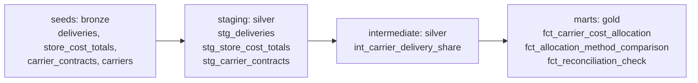

# Carrier Cost Reconciliation with dbt

A small dbt project (dbt-core + DuckDB) that reconciles a monthly logistics cost booked by Controlling
against the carriers who delivered the goods. It models a reconciliation problem I solved at work in a
different technology stack. **All data in this repository is synthetic. No employer data or code is used.**

## The problem

Controlling books one logistics cost per store and month. Logistics must split it between carriers.
The old rule gave the whole month to the carrier with the latest contract start date. When a carrier
changes mid-month, that is badly wrong: in the synthetic example (store `S003`, April 2026) the new carrier
starts on 21 April and delivers 7% of the month's deliveries, but the old rule charged it 100% of the cost.

The new rule allocates cost by each carrier's **share of deliveries per store and month**, and a test proves
that the allocation adds back up to Controlling's total.

| Carrier | Delivery share | Old rule | Delivery-share rule |
|---|---|---|---|
| C01 | 93% | 0.00 | 9,300.00 |
| C02 (new) | 7% | 10,000.00 | 700.00 |

## Layers



| Layer | dbt folder | What it does |
|---|---|---|
| Raw (bronze) | `seeds/` | Synthetic source data as CSV |
| Cleaned (silver) | `models/staging`, `models/intermediate` | Typing, derived month, delivery share (the allocation key) |
| Analytics (gold) | `models/marts` | Allocation, old-vs-new comparison, reconciliation check |

## Tests

- Generic tests in `models/schema.yml`: `unique`, `not_null`, `relationships`, `accepted_values`
- Singular tests in `tests/`:
  - every store-month reconciles to Controlling's total (tolerance 0.05 for cent rounding)
  - delivery shares sum to 1 per store-month
  - one Controlling total per store and month

## Run it

```bash
python -m venv .venv && source .venv/bin/activate     # Windows: .venv\Scripts\activate
pip install -r requirements.txt
dbt build --profiles-dir .        # seeds, models and tests
dbt docs generate --profiles-dir . && dbt docs serve --profiles-dir .   # lineage graph and model docs
```

Use Python 3.10 to 3.12. The synthetic seeds can be regenerated with `python scripts/generate_seeds.py`.
A GitHub Actions workflow (`.github/workflows/ci.yml`) runs `dbt build` on every push.

## Notes and limits

- Synthetic data, small scale, DuckDB for convenience. It demonstrates modelling, testing and documentation
  practice, not production scale.
- Rounding each carrier's share to cents can leave a difference of a few cents, which is why the reconciliation
  test has a tolerance. A production version could assign the remainder to the largest carrier.
